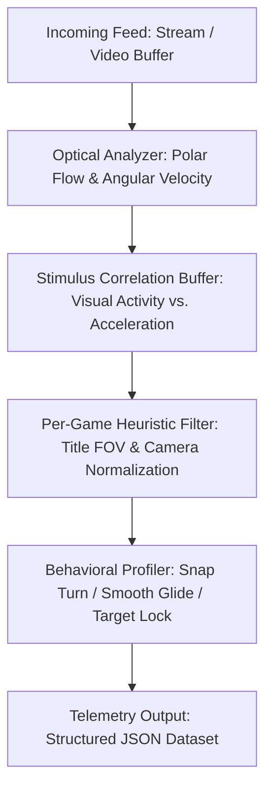

Game Camera Telemetry & Behavioral Profiling System
An open-source, computer-vision-based telemetry pipeline designed to extract camera rotational dynamics, visual stimulus metrics, and player handling styles directly from game stream video feeds—without requiring custom engine hooks or memory injection.
Architecture Overview
This system converts raw video streams into actionable camera behavior datasets. By evaluating the relationship between rotational optical flow and regional visual changes, it infers player intent and movement style to train adaptive, auto-framing camera heuristics.

core-design-principles
1. Per-Game Rationalization Strategy
This system must be calibrated and deployed on a strict per-game basis.
Camera ergonomics, camera-arm stiffness, screen-space spatial layouts, field-of-view (FOV) scaling, and deadzone curves vary drastically across genres and engines:
 * First-Person Shooters (FPS): Characterized by high angular velocity, rapid snap-turns, and low camera smoothing.
 * Third-Person Action/Adventure: Balanced between character tracking and environmental framing, relying heavily on dynamic spring-arm dampening.
 * Real-Time Strategy / Top-Down: Low rotation, high directional translation, and edge-panning behaviors.
Attempting to apply a single, generalized camera model across all game titles results in erratic behavior, poor framing, and broken player muscle memory. Every game environment demands its own contextual profile, baseline normalization, and tuned optical flow threshold.
2. Human-in-the-Loop & Ethical Design
Automating camera translation from desktop/console formats to mobile or auto-framing platforms introduces technical and labor challenges. This project is built around a Human-in-the-Loop (HITL) operational philosophy:
 * Augmentation over Replacement: The automated telemetry pipeline is designed to generate candidate camera profiles and reduce redundant manual keyframing. It acts as an assistant for camera designers, level designers, and porting engineers—not a replacement.
 * Preserving Technical Artistry: Hand-crafted camera curves, cinematic framing, and genre-specific feel require human intuition and creative direction that raw optical flow datasets cannot replicate on their own.
 * Mitigating Disruption: By positioning auto-camera algorithms as baseline generators, studios can streamline cross-platform porting pipelines while preserving the technical art and camera-design roles responsible for tuning the final feel.
Key Features
 * Angular Velocity Tracking: Uses polar optical flow relative to the viewport center to separate camera rotations (yaw/pitch proxies) from flat translation.
 * Visual Stimulus Correlation: Measures frame-to-frame pixel delta intensity to establish why a camera adjustment occurred (e.g., reacting to sudden movement vs. passive scenic panning).
 * Behavioral Style Profiling: Categorizes movement into operational profiles (e.g., Aggressive Snap, Smooth Cinematic Glide, Target Lock), mimicking mechanical control scheme options like Southpaw or alternate deadzone presets.
 * Zero-Engine Footprint: Works entirely through external video capture, making it compatible with emulator streams, console capture cards, and archived footage.
Data Schema Output
The pipeline outputs structured JSON data per analyzed frame block:
[
    {
        "frame": 120,
        "timestamp_sec": 4.0,
        "angular_velocity_deg_s": 18.42,
        "motion_magnitude": 6.12,
        "visual_stimulus_index": 14.85,
        "acceleration": 5.10,
        "style_classification": "Aggressive Snap"
    }
]

Deployment Workflow
 * Ingest Stream: Feed a raw gameplay video file (.mp4, .mkv) or live RTMP capture buffer into the extractor script.
 * Train Per-Game Profile: Aggregate 10+ hours of varied gameplay per game title to establish baseline visual stimulus thresholds and average rotational velocities.
 * Export Heuristic Weights: Use the resulting JSON dataset to train or tune the target platform's camera controller (e.g., Godot Camera3D dampening or Unity Cinemachine virtual camera parameters).
